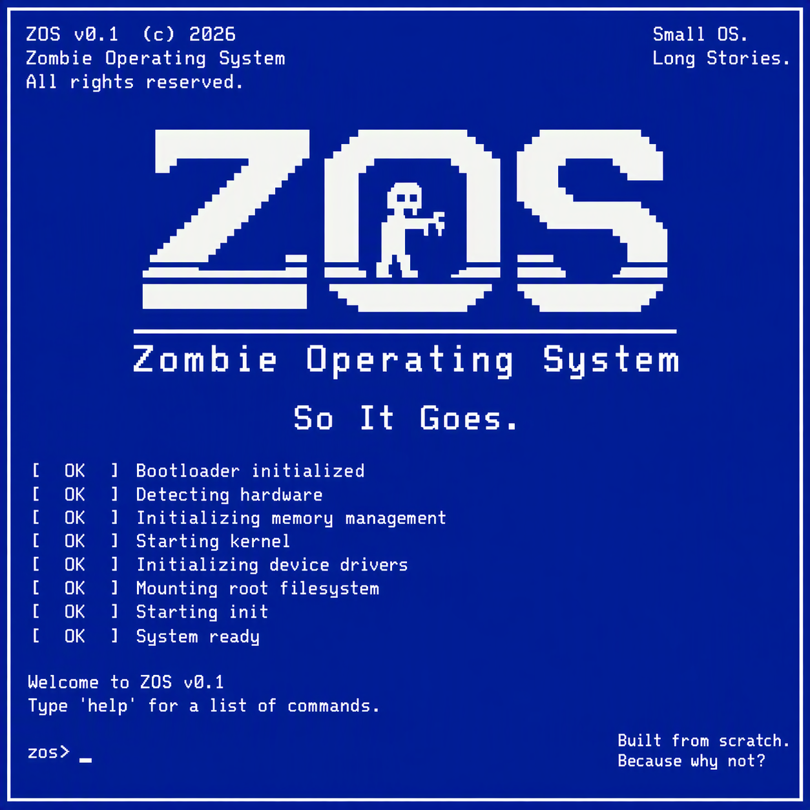
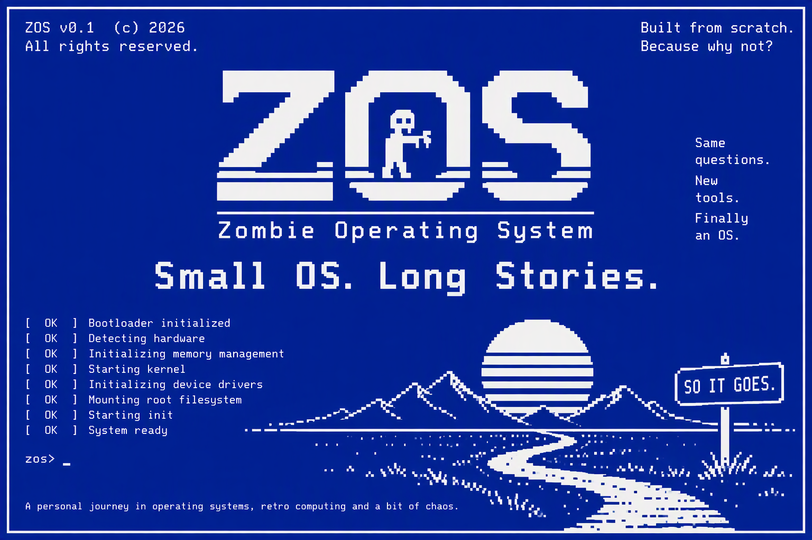

# ZOS - Zombie OS

<p align="center">
  
</p>

A single-core x86-64 microkernel project following the supplied
`MICROKERNEL_OS_PLAN.md`. Rust, Limine, BIOS + UEFI, and serial-first debugging.

<p align="center">
  
</p>

## Current checkpoint

**Status (November 2026):** ZOS boots from a USB stick into an interactive shell with
persistent files. It is verified in QEMU (78 acceptance cases, BIOS and UEFI) and on
one real laptop (Intel xHCI USB controller, built-in PS/2 keyboard). It is an
experimental teaching/hobby kernel, not a general-purpose OS: the filesystem is 16 MiB
(64 files, 24-character names, 64 KiB per file), only xHCI USB storage and
PS/2/USB-HID input are supported, and I2C/SPI keyboards and touchpads are not.
See the root [project plan and execution record](MICROKERNEL_OS_PLAN.md) for
completed phases, research notes and deferred work, and the sections below for how
to build, run and prepare a USB stick. Licensed under MIT OR Apache-2.0
(see [License](#license)).

Generated boot images, executables, USB staging binaries, and build caches were
removed at the user's cleanup request. Source/Git history, portable tools, data
disks, screenshots and test evidence remain; the retained USB manifest is
historical metadata, not a complete ready-to-copy package.

- Step 1: workspace and local Git repository created; tagged `phase-1`.
- Step 0: portable Rust, MinGW, QEMU, and Limine installed and validated.
- Step 2: compiled and boot-tested in **both BIOS and UEFI**. Includes COM1,
  framebuffer text using an embedded bitmap font expanded to 8x16 pixels,
  GDT/kernel-user segments/TSS, exception IDT, and a 100 Hz PIT with PIC forwarding.
- Host tests: GPT CRCs, primary/backup structures, FAT32 geometry/mirrors,
  bootloader long filenames, file cluster chains, EFI paths, output-path
  restrictions, acceptance-log validation, test VM exit behavior, sequential
  QMP capture negotiation, memory-test RAM sizing, user ELF packaging, separate
  user linker flags, and memory/IPC/console acceptance gates. Rust host tests
  exercise keyboard modifiers/releases, mouse packet decoding, editor/history
  boundaries, scrolling, colors, cursor pixels and pointer restoration.
  Storage tests cover formatting/preservation, crash and torn-write recovery,
  corrupt metadata, file/inode limits, paths, owned descriptors and stale handles.
  Session tests additionally cover quotes, sequencing, redirection, checked
  startup packets and compact executable packaging.
- Step 3: bitmap physical-frame allocation from Limine's usable regions;
  ZOS-owned page tables; 4 KiB map/unmap/protect; per-process lower halves
  sharing supervisor-only kernel mappings; an 8 MiB coalescing kernel heap
  supporting `Box`/`Vec`; and usable/free/used memory accounting.
- Step 4: ring-3 ELF processes, per-thread kernel stacks, preemptive priority
  scheduling with round-robin peers, synchronous IPC with transitive priority
  inheritance, checked syscalls, `libos`, and an echo server/client demonstration.
- Step 5: separate ring-3 framebuffer console, PS/2 keyboard/mouse input and
  line-editing TTY servers. The dedicated console regression remains an input demo.
- Step 6: separate ring-3 ATA block, fs-simple and VFS servers; a dedicated
  persistent data image, hierarchical files/directories and reboot verification.
- Step 7: a ring-3 process manager and **interactive command shell**, executable
  loading from VFS paths, reusable generation-checked PIDs/channels, exit/fault
  status, automatic spawned-process descriptor cleanup, and memory reporting.
- Step 8: **QEMU xHCI USB keyboard/mouse and persistent USB storage**.
  PCI discovery and hardware-capability mappings remain in the kernel; controller,
  HID and bulk-only SCSI drivers run in ring 3. Physical-PC validation is deferred.
- Step 9: **read-only Intel/QEMU USB diagnostics** and a guarded Windows USB
  preparation script. Intel `8086:4ded` is allowed only in this diagnostic build.
  Physical-laptop validation is still required; this is not a hardware-ready shell.

The `phase-2` tag preserves the verified boot checkpoint. The `phase-3` memory
checkpoint preserves **Step 3 / Phase 2** in the supplied plan. The
`phase-4` tag corresponds to **Step 4 / Phase 3**; `phase-5` corresponds to
**Step 5 / Phase 4**; `phase-6` corresponds to **Step 6 / Phase 5**;
`phase-7` corresponds to **Step 7 / Phase 6**; `phase-8` records the QEMU USB
preparation for **Step 8 / Phase 7**, not physical-hardware acceptance.
Repository tags follow step numbers.

The frame bitmap and copied page tables are reserved from usable RAM. Bootloader
reclaimable memory stays reserved: boot responses and the initial kernel stack
still live there. The kernel owns its active page-table hierarchy but preserves
Limine's kernel/HHDM/device mappings. Each process owns its root, lower-half page
tables and zero-initialized data frames; destroying an inactive address space
releases them, never the shared kernel half or borrowed device frames. The console
alone can map the boot framebuffer as writable, user-accessible, NX device pages;
page-table ownership bits prevent returning device memory to the RAM allocator.
All memory-manager and heap mutations
run with interrupts disabled under their respective locks on this single CPU.
Memory statistics count initially usable RAM, including ZOS allocations, not
firmware-reserved RAM or the whole installed-memory capacity. The heap is fixed
at 8 MiB for this phase.

User processes enter initially through IRETQ, issue SYSCALL, and return from
syscalls through SYSRETQ. Timer switches restore full general-register and
x87/SSE state; AVX/XSAVE execution is deliberately disabled until its state is
supported. Each thread has a 32 KiB kernel stack, a 64 KiB user stack separated
from other stacks by an unmapped guard gap, and a priority from 0 (highest) to 31.
Kernel dispatch runs with interrupts disabled and never suspends a kernel call
stack. An independent idle stack permits safe final address-space/stack cleanup.
User faults terminate only the offending thread; other threads continue.

The syscall ABI uses RAX for the call/result and RDI/RSI/RDX/R10/R8 for arguments;
Receive also returns message length in RDX. The nine planned syscalls are
implemented, plus bounded serial `DebugWrite`, capability-checked `FramebufferMap`,
and test-only `ConsoleTestFinish` and `StorageTestFinish`. Lifecycle calls are
restricted to the initial process manager; it authenticates shell/child RPCs.
Ordinary demo processes retain the **64-byte** copied-message limit.
Storage, console/TTY/shell, manager and spawned command processes receive a
**1024-byte** copied-message limit for bounded lines, sectors and VFS payloads;
oversized buffers return an error, never truncated data. Large shared-message
mapping is deferred, as allowed by the plan's start-with-copy decision. Send
blocks until a server-owned, generation-checked Reply or an explicit channel
closure error. Dependency cycles are rejected; donation propagates transitively
while queued and while awaiting a reply. All user buffers are checked page by
page and copied through kernel physical aliases, including cross-page buffers.

The regression demo's echo-server alone can attach **IRQ0 and port 0x80**.
After it finishes and releases its resources, the input server alone can attach
**IRQ1/IRQ12 and ports 0x60/0x64**. IrqAttach delivers coalesced notifications
containing the actual IRQ number through an owned channel, reserving reply token
0 for notifications. The input driver drains controller data in user space;
the kernel only forwards IRQs and handles PIC masks/cascade/EOI. IoPortGrant
enables exact approved ports in the requesting thread's TSS I/O bitmap. The
block server alone may grant secondary ATA ports **0x170-0x177 and 0x376**;
primary/boot-disk ports stay denied. ATA interrupts are disabled and the driver
uses bounded PIO polling, IDENTIFY, LBA28 read/write and FLUSH CACHE. IOPL
remains zero and all other ports stay denied. MapMemory supplies individual
zeroed pages in a restricted user range,
rejects writable-executable mappings and overlaps, and caps dynamic allocations
at 128 pages per process. There are 32 thread slots and 16 channel slots.
The original demo allows eight stacks per address space; Step 7 spawned programs
are single-threaded and cannot create threads. Reaped process slots and closed
channels are reusable with generations; stale identifiers cannot target a replacement.

Thirteen freestanding user ELFs are packaged as Limine modules. The loader checks
ELF64/x86-64 headers, file bounds/overflow, page-separated load segments,
executable entry points, overlap, image limits and W^X. User builds use their
own lower-half linker script and `target\user` artifacts. Their code model
matches the prebuilt freestanding Rust core for LTO compatibility, with all ELF
symbols below 2 GiB. Step 5 reuses the already pinned bitmap-font dependency.

The console owns the framebuffer after kernel boot output hands it off; serial
diagnostics remain enabled. It renders an 8x16 cursor, real scrolling, RGB colors,
backspace, and a mouse crosshair that turns red while a button is pressed.
The current grid supports 64-128 columns and 2-48 rows; the boot image requests
1024x768 RGB32. The input driver selects native scan-code set 1 with controller
translation disabled and a standard three-byte PS/2 mouse. Initialization and
controller drains are bounded and fail explicitly. Keyboard support is US ASCII
with Shift/Caps Lock, extended arrows/Home/End/Delete, and Ctrl+A/E/L.
The TTY supports insertion, Backspace/Delete, cursor movement, and eight history
entries with draft restoration. Lines are limited to **120 ASCII characters**;
extra characters report `TTY LIMIT` on serial without corrupting the editor.
Long lines scroll horizontally to keep the cursor visible. Normal Enter executes
commands; the dedicated console regression still echoes `You typed: ...`.
Click inside QEMU to focus keyboard/mouse input; Ctrl+Alt releases mouse capture.

## QEMU USB checkpoint

```powershell
python tools\zos.py run --usb --firmware uefi
python tools\zos.py run --usb --firmware bios
```

These commands attach QEMU's xHCI controller, a boot-protocol USB keyboard and
mouse, and a separate 16 MiB USB mass-storage volume at `/`. The default USB data
file is **`build\data-usb.img`**, created only if absent; the ordinary PS/2/ATA
configuration and `build\data.img` remain unchanged. Use `--data-image
data-usb-scratch.img` for another dedicated volume. Close its VM before reopening
the same volume. The boot image is still Limine-loaded from snapshot-protected
IDE; this does not test firmware booting ZOS from a physical USB stick.

Serial must report `PCI XHCI PASS`, three `USB ENUM PASS` devices, `USB SCSI PASS`,
`USB CAPABILITIES PASS`, `BLOCK ready: USB bulk-only SCSI` and `SHELL ready`.
The input process exclusively owns the controller and proxies block requests
from the authenticated block service. Its send-on-ready IPC queues HID events
when the shell is executing, avoiding a circular dependency with USB-backed
filesystem operations. IRQ0 can notify both input and process manager.

The kernel grants only the selected QEMU `1b36:000d` controller, a checked
4-64 KiB uncached/NX PCI BAR, and at most 64 owned DMA pages. Bus mastering starts
after controller reset; it is disabled before DMA frames are released. Other
processes cannot map controller registers, obtain physical DMA addresses, access
ATA/PS2 ports in USB mode, or issue raw USB block RPCs. **There is no IOMMU**:
the USB driver is trusted, and these grants do not isolate malicious DMA.

This checkpoint supports exactly three direct-root devices: one HID boot
keyboard, one three-byte boot mouse, and one 512-byte-sector, 16 MiB bulk-only
SCSI disk with LUN 0. It polls xHCI events using the 100 Hz timer, supports
32/64-byte contexts and ring cycle/link handling, and uses bounded waits/queues.
Hubs, composite devices, scratchpad-requiring controllers, UAS, keyboard repeat,
hotplug/recovery and arbitrary physical controllers are not supported.
Missing/unsupported devices fail explicitly without a PS/2/ATA fallback.
Disconnecting an enumerated device takes the driver offline; transport failures
poison the disk until restart. No physical disk or USB stick has been written.

## Intel laptop diagnostic checkpoint

```powershell
python tools\zos.py image --diagnostic
python tools\zos.py run --diagnostic --firmware uefi
```

This creates `build\zos-diagnostic.img` and the separate five-file UEFI package
`build\usb-diagnostic-files`. Only console and USB input/diagnostic services
start: **no filesystem, block server, process manager, or shell**. Regular
`run --usb` remains the QEMU-only persistent shell configuration.

The diagnostic kernel allows QEMU `1b36:000d` or Intel Jasper Lake `8086:4ded`,
one eligible controller, a 4-64 KiB BAR, up to 34 scratchpad buffers, and 64
DMA pages below 4 GiB. With 34 scratchpads, controller structures and three
fully allocated device slots use at most 63 of those DMA pages.
It requests firmware ownership, validates standard
USB2/USB3 speed-ID tables, resets the controller and reports capabilities,
connected root ports, supported device IDs, capacity, and a first-sector read.
Enumeration can succeed with zero devices; unsupported protocols/devices and
duplicate device kinds are reported and skipped. At most one direct-root boot
keyboard, mouse and bulk-only SCSI disk can be configured. Hubs, composite
interfaces, UAS, nonstandard speed tables, multi-LUN disks and hotplug recovery
remain unsupported. READ CAPACITY(10) limits disk discovery to fewer than
2^32 blocks; the normal 16 MiB geometry restriction is removed only here.
Non-512-byte block sizes are reported without a sector read.

The SCSI transport allowlists only readiness, inquiry, sense, capacity and read
commands in diagnostic mode. WRITE, FLUSH and every block RPC are denied before
submitting USB transfers. No diagnostic command mounts or modifies a disk.
The screen reports `DIAGNOSTIC READ ONLY PASS` and `DIAGNOSTIC READY`; typing
shows key events and moving the mouse moves the pointer. Device disconnect or
an initialization/runtime error is displayed explicitly and requires reboot.

QEMU tests boot this image from USB in BIOS/UEFI, exercise HID and disconnect,
and separately attach its 128 MiB disk strictly read-only. The bundled EDK2
USB mass-storage firmware driver faults on write-protected media, so UEFI USB boot
uses a disposable QEMU snapshot overlay. The independent read-only-media case
boots via IDE, inserts the USB disk after firmware exits but before ZOS driver
initialization, and checks USB read/write-denial proofs and unchanged image hashes.
This firmware workaround does not add a writable path to the ZOS driver.

### Prepare a physical USB key (Windows, UEFI only)

Use an expendable USB key of **1 GiB-2 TiB with 512-byte logical sectors**.
The script removes all its partitions, creates a **512 MiB MBR/FAT32 volume**,
copies just the five hashed diagnostic files and verifies their readback.
The remainder stays unallocated; this is not a secure erase. Using standard
Windows partition/format APIs avoids writing a fixed-size GPT image with an
incorrect backup-header position on a larger disk.

Build the package above, then preview from the repository directory:

```powershell
.\tools\prepare-usb.ps1 -List
.\tools\prepare-usb.ps1 -DiskNumber N
.\tools\prepare-usb.ps1 -DiskNumber N -Write -WhatIf
```

Replace `N` with the USB disk number you verified by size/model. No disk is
selected automatically. The script refuses non-USB, boot/system, offline,
read-only, undersized, unsupported-sector and changed-identity targets, and
targets containing its own script/package/current directory. It validates the
package before any destructive operation.

When ready, run in a PowerShell session that already has disk-administration
rights (the script never elevates itself):

```powershell
.\tools\prepare-usb.ps1 -DiskNumber N -Write
```

Enter the exact requested `ERASE USB DISK N` confirmation only for the intended
key. If policy blocks execution or access, stop and resolve that policy;
do not bypass it. Safely eject after `VERIFIED`.

On the **target Intel laptop**, connect the key and simple wired USB boot
keyboard/mouse directly (no hub/dock), use the one-time **UEFI USB boot menu**,
and ensure the firmware permits this unsigned bootloader (Secure Boot cannot
authenticate it). The laptop's internal/I2C keyboard or touchpad may not work.
Photograph the complete capability/device/readiness or error screen. Type a
few keys and move the mouse; there is deliberately no command prompt. Power
off, remove the key, then select the normal Windows boot entry to return.
Do not treat QEMU success as confirmation that the Intel laptop works.

Mock-only script tests (no USB key or real disk API calls):

```powershell
powershell.exe -NoProfile -File .\tools\test_prepare_usb.ps1
$LASTEXITCODE
```

Expect `USB SCRIPT PASS` and exit code 0. Phase 9 host/native acceptance is
`python tools\zos.py test --diagnostic`; existing user data images are preserved.

### Normal mode on a real USB stick (interactive shell, persistent files)

`python tools\zos.py image --usb` (also produced by `test --diagnostic`) builds
`build\usb-normal-files`: the boot files, a pre-formatted `zos-volume.img` and a
manifest. Prepare a stick with the same guarded script plus `-Normal`:

```powershell
.\tools\prepare-usb.ps1 -List
.\tools\prepare-usb.ps1 -Normal -DiskNumber N -Write -WhatIf
.\tools\prepare-usb.ps1 -Normal -DiskNumber N -Write
```

The stick gets a **GPT** with two partitions: a 512 MiB FAT32 boot volume, and a
16 MiB partition of type `f2ac67b5-91fa-4c46-a324-95b456c3829d` that receives
`zos-volume.img` through a raw write to `\\.\PhysicalDriveN`, verified by readback.
The rest of the stick stays unallocated.

ZOS finds its volume through that GPT type (CRC-checked, exactly one match) and
only if it already starts with the ZOS filesystem signature. All of its writes
go through a window over that partition: the SCSI layer allows a short list of
commands and `WRITE(10)` only to sectors inside the window, so the boot files and
anything else on the stick are never touched. A stick without a ZOS partition, or
with an unformatted one, is refused with no writes. A bare 16 MiB QEMU test
volume that starts with the ZOS superblock is still used whole.

In USB mode the input service also owns the i8042 ports (0x60/0x64) so a laptop's
built-in PS/2 keyboard works alongside USB devices; ATA and all other legacy ports
stay denied. I2C/SPI keyboards and touchpads are not implemented.

**Keyboard.** The built-in i8042 keyboard is asked for scancode set 2 with the
controller's translation enabled (laptop embedded controllers often acknowledge
but ignore a request for set 1, which produced garbage characters on hardware). The
keyboard raises IRQ1 so each byte is read immediately; the 100 Hz timer poll stays
as a backup.

**Logs.** The kernel keeps the last 32 KiB of everything the kernel and services
log. In the shell, `dmesg` prints it and `dmesg > /name` saves a copy; the shell
also saves `/boot.log` on every USB boot. To read them on another computer, from an
elevated PowerShell (the script is read-only and never elevates itself):

```powershell
.\tools\read-zos-volume.ps1 -List
.\tools\read-zos-volume.ps1 -DiskNumber N
python tools\zosfs.py ls  build\zos-volume-dump.img
python tools\zosfs.py cat build\zos-volume-dump.img /boot.log
```

`tools\zosfs.py` also reads a volume inside a disk image
(`--offset-sectors 16384` for the QEMU test sticks). Mock-only script test:
`powershell.exe -NoProfile -File .\tools\test_read_zos_volume.ps1`.

QEMU acceptance covers the layout (`usb-gpt-shell`, which also checks that every
byte outside the partition is unchanged), `usb-ps2` (no USB keyboard/mouse),
`usb-no-zos-partition` and `usb-unformatted-zos-partition`. The raw volume write
by `prepare-usb.ps1 -Normal` is only mock-tested
(`powershell.exe -NoProfile -File .\tools\test_prepare_usb_normal.ps1`); a real
stick is its first true test.

## Interactive shell and processes

Run `python tools\zos.py run --firmware uefi` (or `bios`), click inside QEMU,
and wait for `SHELL ready: interactive ZOS shell, persistent root filesystem`.
At the `> ` prompt, execute the plan's acceptance session:

```text
mkdir a; cd a; echo hi > f; cat f; ps; free
echo "a; > b" >> f; cat f
cp f copy; mv copy renamed; ls
```

Use a fresh directory name if `a` already exists on your persistent volume.
Commands: `help clear ls cd pwd mkdir rmdir touch cat echo rm cp mv free ps
kill wait uname reboot halt`. `ps` reports PID, name, state and resident bytes;
`free` reports real usable/free/used physical memory and kernel-heap usage.
`reboot` and `halt` first synchronize the filesystem.

Single/double quotes, backslash escapes, empty quoted arguments, `;`, `>` and
`>>` are supported. There are no pipes, environment expansion, globbing or
command substitution. Input is bounded to 120 ASCII characters, eight commands
and twelve arguments per command. Paths are relative to `pwd` unless absolute.
`cp`/`mv` require an exact destination path; there is no directory-destination
expansion. Self-copy and cat redirection to an input inode fail before truncation.
`rm` rejects directories; `rmdir` rejects nonempty directories.

The manager loads checked ELF files from `/bin/name` or an explicit VFS path,
not a boot-only executable whitelist. Missing bundled `/bin` programs are seeded
on boot; existing files are preserved, **not upgraded automatically**. Copying
`/bin/true` to another path and spawning that path is covered by acceptance.
The bundled command ELF implements echo/cat/cp and simple true/false/spin/block/
fault/leak/uname helpers according to its invocation name.

External programs may run in the background with `&`; the shell prints their
generation-checked PID. `kill PID` terminates a dynamic process and `wait PID`
reports its exit status, including kill/fault outcomes. System services cannot
be killed. Up/Down recall history; Ctrl+L clears the screen. Background jobs
retain their bounded status slot until `wait`; there are at most 24 tracked jobs
and 32 total process/thread slots. Spawned programs are single-threaded and
receive no hardware, framebuffer or lifecycle capability. Cleanup releases
their address space, dynamic pages, kernel stack, channels and owned VFS FDs.

## Persistent filesystem

Normal `run`/`debug` automatically creates `build\data.img` **only if absent**,
then mounts it at `/`. The boot disk remains snapshot-protected; this dedicated
16 MiB data volume is attached as secondary IDE master without snapshots.
`welcome.txt` is created only when missing, read back and left intact on subsequent
boots. Invalid existing geometry/checkpoints fail explicitly, never trigger
automatic formatting. Close QEMU before opening the same data image again.

The custom volume is not FAT/ext and is not directly mountable by Windows. It
contains a checksummed superblock, 64 inodes (including root), a block bitmap,
parent/name directory records and two checksummed metadata banks. Names are up
to 24 printable ASCII bytes, absolute paths up to 192 bytes and files up to
64 KiB (sixteen direct 4 KiB blocks). There are no indirect blocks, permissions,
links, a dynamic service registry or multiple mounted filesystems.
The inode/direct-pointer limits constrain usable file capacity below the 16 MiB
volume size.

Updates copy file data to unused blocks and preserve every block referenced by
either valid checkpoint. Commit ordering is data flush, inactive metadata-body
write/flush, then generation/checksum header write/flush. Mount selects the newest
valid checkpoint; malformed trees, duplicate blocks and inconsistent bitmaps are
rejected. Ambiguous write/flush failures take the filesystem offline until remount.
Data contents themselves are not checksummed. Host tests simulate cache loss and
torn sectors at every write/flush boundary for writes, create, rename, unlink and
truncate; reboot must recover an entire old or new checkpoint.

VFS supports open/read/write/close/stat/readdir/mkdir/unlink/rename, append,
truncate and sync. Paths are lexically normalized (`.`, `..`, repeated `/`);
escaping above root fails. Its 64 descriptors carry generation handles and are
owned by the kernel-authenticated calling thread, not an owner field supplied
by a client. Stale/foreign handles and access-mode violations fail. Unlink of an
open inode is denied; rename preserves live descriptors and does not overwrite an
existing destination. Clients normally close descriptors explicitly. The manager
closes all descriptors owned by an exited, killed or faulted spawned process
before reaping/reusing its slot. Each read/write RPC transfers at most 1000 bytes
and returns the actual count; larger files use repeated calls. FS and block
backend channels accept only their designated VFS/FS caller respectively.

To create a separate volume or explicitly erase a selected existing volume:

```powershell
python tools\zos.py mkfs --data-image data-scratch.img
python tools\zos.py run --firmware uefi --data-image data-scratch.img
python tools\zos.py mkfs --data-image data-scratch.img --force
```

Only `data.img` or `data-<name>.img` directly inside `build` are accepted. Mkfs
formats the entire dedicated volume image; it does not modify the boot GPT/ESP
or any physical disk. Its format matches the user-space filesystem implementation.

## Windows setup (no WSL or administrator installation)

Prerequisites: Windows x86-64, Python 3.10+ and Git on PATH, internet access,
and sandbox permission to execute this project's tools and downloaded binaries.
All downloaded dependencies stay in ignored `.tools`; the scripts do not
change the system PATH, install drivers, or run installers.

After updating sandbox policy to permit `tools\bootstrap.ps1`, run from this
repository in PowerShell:

```powershell
.\tools\bootstrap.ps1
python tools\zos.py fmt
python tools\zos.py test
```

Do not bypass the sandbox with elevation or alternate script execution.
If another project path is blocked, allow that path in sandbox policy first.
The formatting command is useful after editing Rust source; the committed
source already passes the formatting gate.

The setup uses a project-local GNU-hosted Rust toolchain plus portable MinGW
for host-side procedural macros, avoiding a Visual Studio C++ installation.
Pins: Rust `nightly-2025-03-01`; Limine binary commit
`ee5d29cd0a8034612dcd1df3f00052480db785c5` on `v9.x-binary`;
Limine Rust bindings `0.6.5`, explicitly requesting protocol base revision 3;
QEMU Windows build `20260811`; MinGW `16.2.0-rt_v14-rev1`; 7-Zip `26.06`.
The kernel pins `spin` version `0.9.9` and uses `linked_list_allocator` `0.10.5`
without its optional locking dependency. `Cargo.lock` records the
verified transitive dependency versions; builds and Clippy use `--locked`.

The image builder uses Python's standard library instead of WSL's `gdisk`,
`mtools`, and `xorriso`. It produces a 128 MiB GPT image with a dedicated BIOS
stage-2 partition and a FAT32 EFI System Partition, then invokes the pinned
`limine.exe bios-install` on **that image file only**. Native Windows commands
below are the primary interface; the Makefile is optional if Windows Make is
already available. `tools/mkimage.sh` is a convenience wrapper for Git Bash.

## Acceptance gates

`python tools\zos.py test` runs the legacy Step 7 regressions.
**`python tools\zos.py test --usb`** additionally runs Step 8 USB acceptance.
Both must exit successfully. The shared checks perform:

1. Python and Rust host unit tests, Rustfmt check, and Clippy with warnings
   denied for normal and all twelve test kernels, USB and USB-shell kernels,
   and all four user packages (sixteen configurations total). USB tests cover
   malformed descriptors, endpoint companions, HID rollover/modifiers,
   stale/malformed bulk status and strict no-fallback harness validation.
2. BIOS and UEFI boots for each of twelve isolated test images. Each must
   report the correct firmware, framebuffer initialization, GDT/TSS/IDT, and
   at least 100 timer interrupts; then exit through QEMU's test device with
   host status 33. A panic, unexpected exit, missing marker, or timeout fails.
   Every image checks `Box`/`Vec`, alignment, zeroed user pages, real CR3 switches
   with isolated contents at the same virtual address, shared kernel mappings
   added after process creation, protection flags and leak-free teardown.
   The memory image uses **1 GiB RAM** to hold 100,000 distinct pages at once,
   verify their contents, free them and reject double frees. It also exhausts
   the allocator, checks partially constructed mappings roll back on failure,
   recovers, and verifies heap fragmentation/coalescing and oversized-allocation
   failure without leaks. Three dedicated fault images check the CPU's exact
   page-fault address and error bits for a read-only write, a read after unmap
   (including TLB invalidation), and an instruction fetch from an NX page.
   The IPC image runs real ring-3 code in seven address spaces: an echo server,
   client, and five disposable fault probes. It checks cross-process messages,
   blocked request/reply, priority donation ahead of a medium-priority competitor,
   syscall-free peer loops requiring timer preemption, SSE state preservation,
   IRQ notification, allowed/denied I/O, invalid pointers and priorities,
   cross-page copies, small-buffer errors, stale/forged reply tokens, deadlock
   rejection, and closure while queued or awaiting a reply. Supervisor writes,
   CLI, UD2, denied OUT and a noncanonical syscall stack must be contained;
   the echo must complete after these faults. All six surviving threads must
   exit successfully. Final frame/heap totals must return exactly to baseline.
3. The console image additionally receives actual QMP keyboard and mouse events:
   Backspace, arrows, insertion, Home/End/Delete, history recall, Shift/Caps Lock,
   mouse movement and button press/release. Expected text and exact pointer
   coordinates must match. It captures the edited screen, then terminates all
   three services and verifies exact frame/heap recovery, including borrowed
   framebuffer mappings. Its finish syscall is denied in production images.
4. For each firmware, fs-create formats a separate `data-test-<firmware>.img`,
   exercises VFS CRUD, path normalization, access modes, descriptor ownership,
   stale handles and quotas, and commits 8197 patterned bytes across sector/block
   boundaries. QEMU exits completely. Fs-read boots a new VM against that same
   non-snapshot data image and verifies exact contents, metadata and EOF. The
   create image must change its hash; the read image must leave it unchanged.
   Both check exact frame/heap cleanup. Normal `data.img` is never reformatted
   by these disposable persistence tests.
5. Shell BIOS/UEFI cases drive actual PS/2 keys through the plan's session,
   quotes, append, file commands, self-truncation rejection, editing/history,
   background/kill/wait and real ps/free. Forty repeated spawns verify slot reuse,
   stale PIDs, exit/fault status and exact memory recovery. Blocked-process kills
   check stale channels and automatic descriptor cleanup. A fresh QEMU instance
   reads exact persisted contents; separate commands reset the guest and halt
   its CPU in ring 0. Test-only finish verifies complete service/resource teardown.
6. Normal BIOS and UEFI boots, each with a framebuffer screenshot. These do
   not enable the test exit device. The harness stops each VM through QMP over
   standard input/output, without opening a network listener.

USB acceptance additionally repeats the full keyboard-driven shell session in
both firmwares, checks exact mouse movement/button coordinates and saved screen
captures, copies files while another key is queued, then verifies exact contents
after a complete VM restart. It exercises real reboot/halt, DMA-pointer rejection,
quota exhaustion, NX MMIO, non-owner capability denial, authenticated raw-block
denial, command/event/bulk/HID ring wraps and complete frame/heap recovery.
Missing controller/disk, unsupported HID and disk-disconnect cases must fail
explicitly without unintended driver faults, fallback or further data writes.
All volumes are dedicated generated image files; neither normal user volume is
reformatted by acceptance.

Outputs are ignored under `build`:

```text
bios-boot.serial.log             uefi-boot.serial.log
bios-divide.serial.log           uefi-divide.serial.log
bios-page-fault.serial.log       uefi-page-fault.serial.log
bios-memory.serial.log          uefi-memory.serial.log
bios-memory-protection.serial.log uefi-memory-protection.serial.log
bios-memory-unmap.serial.log     uefi-memory-unmap.serial.log
bios-memory-execute.serial.log   uefi-memory-execute.serial.log
bios-ipc.serial.log              uefi-ipc.serial.log
bios-console.serial.log          uefi-console.serial.log
bios-fs-create.serial.log        uefi-fs-create.serial.log
bios-fs-read.serial.log          uefi-fs-read.serial.log
bios-fs-create.data.json         uefi-fs-create.data.json
bios-fs-read.data.json           uefi-fs-read.data.json
bios-screen.ppm                 uefi-screen.ppm
bios-console.ppm                uefi-console.ppm
bios-shell-session.ppm          uefi-shell-session.ppm
bios-shell-reboot.ppm           uefi-shell-reboot.ppm
bios-shell-power.serial.log     uefi-shell-power.serial.log
bios-shell.data.json            uefi-shell.data.json
phase-7-acceptance.json          (created only after automated success)
phase-8-acceptance.json          (test --usb, includes all legacy regressions)
zos-usb.img                     (normal USB configuration)
data-usb.img                    (persistent USB filesystem)
<firmware>-usb-shell-*.serial.log (USB shell, restart and power evidence)
<firmware>-usb-shell-*.ppm       (USB session/restart framebuffer captures)
zos.img                         (normal image, never a deliberate-fault image)
data.img                        (persistent normal filesystem)
data-test-bios.img              data-test-uefi.img (isolated acceptance volumes)
```

Inspect all eight screenshots: two normal shell prompts, two console-regression
screens and four shell-session/reboot screens. Confirm readable text,
prompt/cursor, command/file/process/memory output and the mouse crosshair.
With `--usb`, also inspect two USB normal prompts and four USB session/restart
captures (fourteen screenshots total).
Earlier IPC/isolation diagnostics remain in the serial log.
The JSON explicitly records visual review as pending. Alternatively,
verify the screen interactively, closing each QEMU window before the next:

```powershell
python tools\zos.py run --firmware bios
python tools\zos.py run --firmware uefi
```

Expected normal serial/screen lines include:

```text
ZOS - Zombie OS
ZOS booting
FRAMEBUFFER ready: 1024x768, embedded 8x16 font
FIRMWARE: BIOS
GDT/TSS/IDT ready
PAGING ready: ZOS-owned root, shared supervisor kernel half, WP/NX
HEAP ready: 8388608 bytes
HEAP PASS: Box, Vec growth, alignment, deallocation
PAGING PASS: map/unmap/protect, CR3 isolation, shared kernel, teardown
MEMORY ready: usable=... free=... used=... heap_used=0 bytes
PIT ready: 100 Hz
TIMER PASS: ticks=100
RING3 ready: SYSCALL/SYSRET, per-thread kernel stacks, FXSAVE
ELF VALIDATION PASS: ...
USER FAULT: ...                  (five intentional, contained probes)
client: cross-process echo and priority inheritance verified
SCHEDULER PASS: ...
IPC PASS: ...
IRQ/IO PASS: ...
USER ISOLATION PASS: 5 faults contained; echo completed afterwards
PROCESS CLEANUP PASS: all address spaces, threads, channels released
CONSOLE PASS: cursor, colors, backspace, scrolling
PS2 ready: set-1 keyboard IRQ1, 3-byte mouse IRQ12
CAPABILITIES PASS: framebuffer, PS/2 ports and IRQs isolated
BLOCK ready: secondary ATA, LBA28, flush, 32768 sectors
FS ready: checkpoint=..., COW metadata/data
VFS ready: root mount, owned FDs, bounded copied IPC
ZOS ready: persistent filesystem and VFS verified
PROCMGR ready: path spawn, kill, wait, stats, reusable PIDs
SHELL ready: interactive ZOS shell, persistent root filesystem
```

UEFI reports `FIRMWARE: UEFI`; resolution and tick count can differ.
The divide test must report `EXCEPTION: DIVIDE ERROR` and
`DIVIDE ACCEPTANCE PASS`. The page-fault test must report its bad address
(`0x400000000000`) and `PAGE FAULT ACCEPTANCE PASS`.

The memory stress case additionally reports `FRAMES PASS: 100000 simultaneous
pages`, `FRAMES OOM PASS`, `HEAP STRESS PASS` and `MEMORY ACCEPTANCE PASS`.
The hardware-fault cases report `MEMORY PROTECTION ACCEPTANCE PASS`,
`MEMORY UNMAP ACCEPTANCE PASS` and `MEMORY EXECUTE ACCEPTANCE PASS`, respectively.
The IPC image additionally reports `IPC ACCEPTANCE PASS`. The console image
reports `TTY PASS`, `CONSOLE CLEANUP PASS` and `CONSOLE ACCEPTANCE PASS`.
Normal boots run the IPC regression demo, then keep console/input/shell,
block/filesystem/VFS and the process manager running at a command prompt.
The storage probe verifies `welcome.txt` and exits. Hardware Step 8 remains deferred.

## Development commands

```powershell
python tools\zos.py build
python tools\zos.py image
python tools\zos.py check
python tools\zos.py debug --firmware bios
python -m unittest discover -s tools -p "test_*.py" -v
```

Debug starts QEMU paused with its GDB stub on port 1234; use a compatible GDB
with `target remote :1234`. Interrupt/reset diagnostics go to
`build\qemu-debug.log`; serial remains enabled.

QEMU runs a single CPU with 256 MiB RAM using software emulation, except for the
1 GiB physical-memory stress test. UEFI uses the
QEMU package's EDK2 code and a fresh per-image copy of its variable store.
Disk access is restricted to generated image files. Only the boot image uses
snapshot mode; the selected dedicated data volume persists writes.
The QEMU tools never enumerate, format, or write a physical drive. Only the
explicit `tools\prepare-usb.ps1 -Write` workflow above prepares a physical USB key.

## Repository and sharing

This is a local repository on `main`; no GitHub remote is configured and
nothing has been published. Tool downloads, generated disk images, logs,
screenshots, and Cargo target output are ignored.

`build\zos-source.bundle`, when supplied with this checkpoint, contains the
committed source and local tags, not dependencies or runtime validation.
It can be shared and cloned without GitHub:

```powershell
git clone .\zos-source.bundle zos
```

Before creating a later source bundle:

```powershell
git bundle create build\zos-source.bundle --all
git bundle verify build\zos-source.bundle
```

## License

ZOS is dual-licensed under either of

- Apache License, Version 2.0 ([LICENSE-APACHE](LICENSE-APACHE))
- MIT license ([LICENSE-MIT](LICENSE-MIT))

at your option. Unless you state otherwise, any contribution intentionally submitted
for inclusion in ZOS by you, as defined in the Apache-2.0 license, is dual licensed as
above, without any additional terms or conditions. Third-party components and their
licenses are listed in [THIRD_PARTY.md](THIRD_PARTY.md).

**Artwork.** `assets/zos-logo.png` and `assets/zos-logo-article.png` are AI-generated
images. They carry their own notice ("All rights reserved") and are not part of the
MIT OR Apache-2.0 licensed source.
